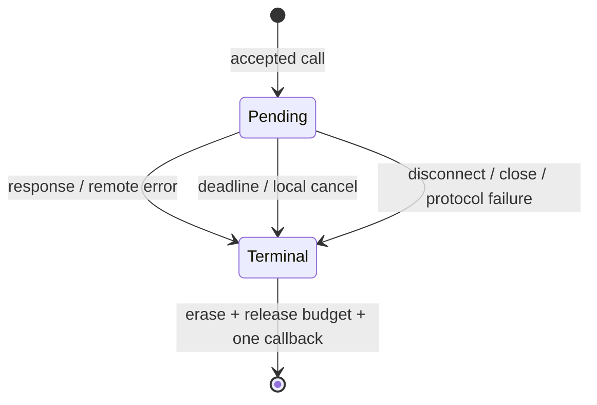

# Callback RPC (RPC-C1)

RPC-C3 extends the existing tests with an independent codec acceptance oracle,
bounded owner-local operation sequences and an eight-generation TCP stress case.
The sequence ledger checks every call after each operation: admission versus
rejection, one local completion, exact pending bytes/count and final zero inbound
and outgoing residue. Fixed seeds run in the ordinary RPC contract; opt-in
libFuzzer targets explore additional codec bytes and state sequences.

```sh
CC=clang CXX=clang++ cmake -S . -B build-rpc-fuzz -G Ninja \
  -DGAMENET_BUILD_TESTING=OFF -DGAMENET_BUILD_FUZZING=ON \
  -DGAMENET_ENABLE_ASAN_UBSAN=ON
cmake --build build-rpc-fuzz --target gamenet_fuzz_rpc_codec gamenet_fuzz_rpc_channel
python3 tests/ci/run_rpc_fuzz.py --build-dir build-rpc-fuzz \
  --output out/rpc-fuzz --runs 20000 --seed 424242
```

Fuzz state execution uses a real owner EventLoop and synthetic bounded transport,
with long deadlines and no sleeps. Existing contracts validate real timeout
delivery separately. Integration pressure uses real sockets, forces send refusal,
resumes held input, requires an echo probe, alternates cancellation and pending
disconnect, and waits for weak lifetimes and budgets to converge before reconnect.
The optional RPC/TLS integration runs the same stress with real authenticated TLS.
These finite checks provide development correctness evidence, not endurance or
fixed-lab capacity/performance evidence.

RPC-C2 adds the focused RpcTransport seam and optional separately installed
[RPC/TLS session](callback_rpc_tls.md). Existing TCP composition below is preserved.

`GameNet::rpc` is a provisional installed C++23 component. Link it with
`find_package(GameNetCore REQUIRED COMPONENTS rpc)` and
`target_link_libraries(app PRIVATE GameNet::rpc)`. The RPC component depends on
Core and PacketFramer; the stable Core does not depend on RPC. The published
v0.3.1 package predates this feature: build/install the PR revision to try it.

The component is a native minimal callback protocol, independent of historical
gateway/YanGame wire formats. It provides one channel per TCP connection, opaque
binary payloads and numeric method IDs. Applications own service dispatch.
The runnable end-to-end composition is `tests/integration/rpc/test_rpc_tcp.cpp`:

```sh
cmake -S . -B build-rpc
cmake --build build-rpc --config Release
ctest --test-dir build-rpc -C Release -R '\.rpc\.' --output-on-failure
```

## TCP composition

Configure TcpServer/TcpClient callbacks before connecting. On connection-up,
create a channel on that connection's owner; a server handler can be:

```cpp
auto channel = gamenet::rpc::RpcChannel::create(connection,
    [](const gamenet::rpc::RpcMessage& request, gamenet::rpc::RpcChannel::Reply reply) {
        if (request.method == 1)
            (void)reply({gamenet::rpc::RpcStatus::Ok, request.payload});
        else
            (void)reply({gamenet::rpc::RpcStatus::RemoteError, "unknown method"});
    });
connection->setContext(channel);
```

The enclosing server/client message callback takes a temporary copy of the
context's shared channel and calls `channel->onMessage(*buffer)`. Its down
callback calls `channel->onDisconnect()` before clearing context. These are
application callbacks; the RPC channel never changes TcpConnection callback slots.
A client on its owner calls:

```cpp
auto admitted = channel->call(1, "hello", std::chrono::seconds(2),
    [](gamenet::rpc::RpcResult result) {
        // Ok, RemoteError, Timeout, Cancelled, Disconnected, Shutdown,
        // ProtocolError or SchedulingRejected. Executed on the connection owner.
    });
if (admitted.status == gamenet::rpc::RpcOperation::Accepted)
    (void)channel->cancel(admitted.requestId); // optional, owner-only
```

Rejected admission has id=0 and invokes no completion. The caller checks the
typed reason (pending limit, transport rejection, invalid argument, unavailable
owner, closed channel or exhausted IDs). `call` can complete synchronously only
through subsequent explicit owner operations such as cancel; an admitted timer
or peer response runs later. Pending count and charged wire bytes return to the
budget before completion, allowing callback re-entry. Completion exceptions are
contained and counted so other requests still settle.

## Deferred handlers and limits

A handler may copy its weak Reply and return. Reply must be invoked on the
connection owner before the request deadline; use the existing bounded executor
to return owned results from another thread and check PostResult. The first
reply consumes the inbound slot. Repeated/expired replies return NotFound;
closed/destroyed channels return Closed. Handler exceptions produce a bounded
remote error. Input payload references are valid only during the handler:
copy/move application data before deferring it.

`RpcOptions` independently bounds outgoing count/charged bytes, inbound deferred
count/charged bytes, payload size, parser buffering, frames per dispatch and
maximum request duration. Charged bytes are outer prefix + RPC header + request
payload until settlement; callback/application allocations are caller-owned.
Transport bytes also remain subject to existing TCP multi-level output budgets.
A handler must be short/nonblocking; RPC does not create a worker or preempt it.
Deadline callbacks cannot run while the owner is blocked. Response/reply handling
still checks steady_clock to reject overdue work before timer delivery.

Cancellation is local: it releases the callback/slot and ignores later replies,
but does not send a remote cancellation or undo side effects. No retries occur.
Incoming requests use monotonic non-reused IDs; stale request IDs or malformed
frames are protocol errors. Unknown/duplicate responses are ignored. Exactly-once
completion does not establish exactly-once execution across reconnects.

## Shutdown and threading

All mutation and snapshots are owner-only; foreign call/cancel/reply/close return
WrongThread. Cross-thread callers post copied/moved values via ownerExecutor;
never capture borrowed spans. The caller/context owns the channel. Timers and
reply handles are weak, and queued continuations temporarily retain the channel.
The EventLoop must outlive it. Close all channels before quitting the loop; close
seals RPC admission and settles pending callbacks as Shutdown, while the caller
controls TCP drain/force-close. A down hook settles as Disconnected. Owner-thread
destruction is a final Shutdown settlement path, with exceptions contained.



Wire details and the five module gate answers are in the active RPC intent.
RPC-C1 evidence is functional development validation. External adoption,
fixed-lab performance and a future release remain separate work.
