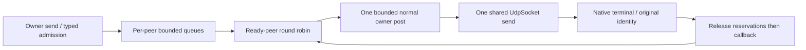

# UDP-C2: explicit bounded peer sessions

`GameNet::udp` now offers `UdpPeerServer` and `UdpPeer` in addition to the
unchanged `UdpSocket`. `GAMENET_ENABLE_UDP` remains OFF by default. Both APIs link
only Core; `UdpPeer` implements the existing header-only `TransportEndpoint`
interface without adding a transport, TLS or reliability dependency. The public
Core API, published v0.3.1 tag and packages are unchanged.

## Why and where

The C1 socket preserves datagram boundaries and owns native readiness/completion.
C2 supplies explicit local peer lifetime, output accounting and fair service so
upper layers can retain endpoint handles without retaining the socket or loop.
It does not infer a player from an IP address. Call `openPeer(address)` on the
owner after start; unknown source packets are counted and ignored. Duplicate live
addresses reject. IPv6 scope is part of the lookup key. An application needing
authentication, reliable order or network replay rejection must add a protocol.

```cpp
auto server = gamenet::udp::UdpPeerServer::create(&loop, local, callbacks, options);
if (server->start() == gamenet::udp::UdpResult::Accepted) {
    auto opened = server->openPeer(remote);
    if (opened.result == gamenet::udp::UdpResult::Accepted) {
        std::shared_ptr<gamenet::transport::TransportEndpoint> endpoint = opened.peer;
        const auto admitted = endpoint->send("one datagram"); // owner only
        // Handle overload explicitly; no automatic application retry queue.
        (void)admitted;
    }
}
```

## Identity and replacement

Every opening has a nonzero session id unique across this process's UDP-C2 servers
plus a slot/generation
identity. Counters never wrap into a live identity. Close seals the old handle;
once its local queue and native receipt settle the slot becomes reusable with a
new generation. A closing peer remains charged against `maxPeers`. Another free
slot may open the same address while the old peer's send is still completing.
The old completion and callback retain the old identity and reservations.
Retaining or posting an old handle cannot send through the replacement.
The allocator does not cover application-assigned TCP endpoint ids. Applications
combining transports must define their identity mapping; this slice does not
extend PlayerSession or create an automatic TCP/UDP dual channel.

This is local generation isolation. UDP wire payloads carry no generation. A
delayed datagram from the same source address may reach the newly opened peer;
C2 cannot identify it as old or authenticate its sender. Closing a peer has no
wire handshake and does not close the shared socket or another peer.

## Owner, ownership and callbacks

One outliving EventLoop owns create/start/openPeer/snapshot/address, mutable peer
records, queues, idle timer, receive delivery and send/close. Foreign send/close
returns WrongThread. Cross-thread `requestClose`, `isOpen`, executor observation,
server stop and wrapper destruction are safe. Close uses a pre-attached lifecycle
signal, even when normal task capacity is full. Callbacks run only on the owner;
they may send, close, reopen, stop, throw or release caller references. A committed
callback may finish after another thread seals close. No later callback commits
through that peer gate. Borrowed message data expires at callback return.

The server wrapper owns state, active state has a settlement lease, and records
own handles. Handles weakly observe state; their immutable identity and synchronized
gate survive server and loop teardown. Timer, normal-post and native bridges are
weak. Dispatch takes a strong state lease across user callbacks. Exceptions seal
the service and remaining obligations continue settling. A caller must keep the
owner running until stopped before destroying the EventLoop. An unstarted stop
has no user callbacks.

## Budgets and data flow

Options bound peer count, per-peer packet/byte retention, global packet/byte
retention, peers scanned per turn and cancellation completions per turn. Empty
packets still occupy packet slots. Limits include the logical native in-flight
packet. The existing socket has one additional bounded copied native packet and
its fixed receive storage; both are separately visible in the socket snapshot.



Each peer gets one packet per round while ready. Native completion precedes the
next selection, so a hot peer cannot consume a second turn ahead of an already
ready cold peer. C1 bounds receive work and native batches. Initial normal-post
refusal rolls back admission; post refusal after admission seals service and
cancels its obligations. Data never falls back onto lifecycle priority.

Steady-clock idle expiry measures last admitted send or delivered receive.
Rejected work does not refresh it. The weak timer checks at most `maxPeersPerTurn`
slots per tick, using a cadence between 1 and 100 ms. Reclamation can therefore
lag the timeout by a bounded scan cycle. Close/stop cancellation likewise scans
in bounded slices, retaining remaining-work debt across the entire scan. This
last invariant has a real three-slot/one-completion-per-turn pressure regression.

## Terminal meaning and observability

Direct `sendDatagram` returns a nonzero id only for accepted owned output;
rejection retains nothing and gets no completion. Endpoint `send` maps size or
resource refusal to Overloaded; direct admission preserves InvalidArgument and
NoMemory. Accepted means local admission; Sent means local OS completion, without
delivery/order/uniqueness promises. Close cancels queued packets but waits for a
submitted send's actual terminal result. Cancelled does not prove it never left
the host. First close reason wins.

For both count and bytes, snapshots enforce:

`accepted = sent + cancelled + failed + pending`

Reservations release before send callbacks. Peer closed occurs exactly once only
after its pending count/bytes are zero. Server stopped follows all peers, timer
cancellation, accepted internal-post retirement and native Stopped, including IOCP
cancellation dequeue. No message callback runs after peer closed. Snapshots also
expose unknown sources, idle closes, stale receipt rejection, callback exceptions,
and observed scan/cancellation turn maxima.

## Reading and verification

- `include/gamenet/udp/UdpPeer.h`: installed contract and options.
- `src/udp/UdpPeer.cc`: peer gates, records, admission, round robin and settlement.
- `tests/contract/udp/test_udp_peer.cpp`: direct identity, bounds, real idle,
  saturated foreign close, native old receipt, quit, reentry/release and 32 fixed
  bounded sequences.
- `tests/integration/udp/test_udp_peer_stress.cpp`: 16 real dual-family generations,
  actual overload then recovery, cold-peer progress and old-handle isolation.
- `tests/support/UdpPeerSequence.h`: independent per-id/per-peer count+byte ledger
  with real owner turns/native output and explicit test-only receive/idle/receipt
  controls. `tests/fuzz/udp/fuzz_udp_peer.cpp` mutates at most 96 actions per input.
- `tests/ci/udp_peer_interop.py`: stdlib-only peer, eight servers, IPv4/IPv6,
  64 delivered messages, 16 empty, 16 truncated, eight explicit rotations and
  eight unknown-source rejections; strict server zero-residue summaries.

`run_udp_contracts.py` records schema v2, 138 Release tests or five UDP sanitizer
tests, C1 and C2 independent peer evidence and installed ON/Core-only/OFF consumers.
The dedicated workflow covers Windows/Linux Release, Windows ASan and Linux
ASan/UBSan/TSan. A separate instrumented job retains and rechecks exactly 20,000
state-fuzz units with seed 424242, fixed seed corpus, source/run/attempt, binary
and evidence hashes. Existing default/TLS/RPC-TLS/WS/WSS and protocol/state fuzz
remain regression gates. Finite correctness runs do not establish capacity,
endurance or production adoption. KCP and PMTU remain separate future work.
